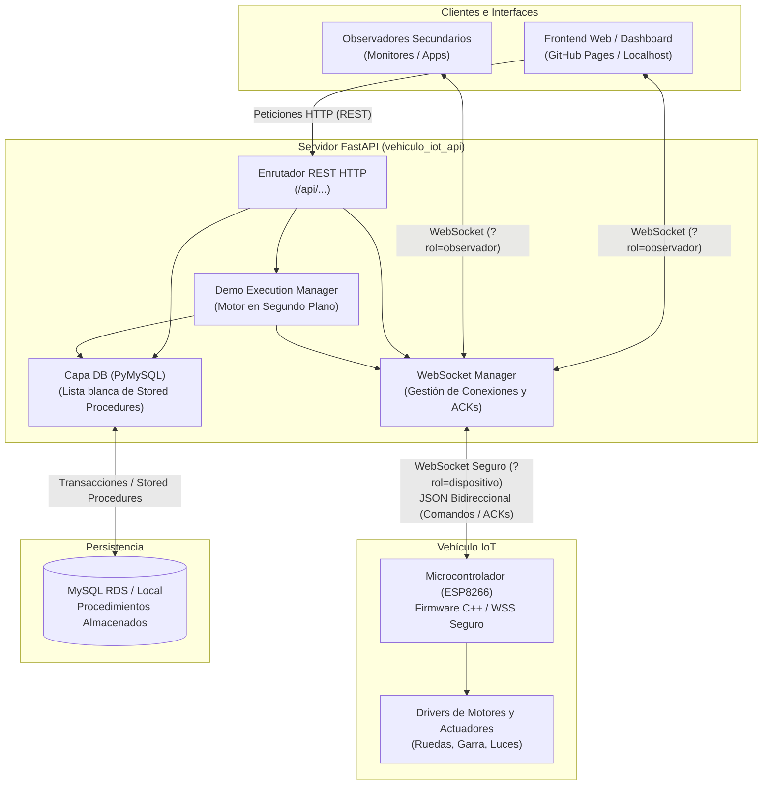
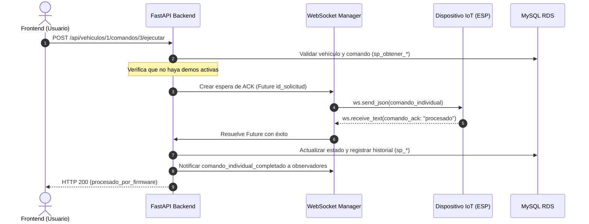

# 🚗 API Vehículo IoT

Sistema backend robusto desarrollado con **FastAPI**, **WebSockets** y **MySQL**, diseñado para el control bidireccional en tiempo real, gestión de secuencias de movimiento automatizadas (demos) y telemetría de vehículos robóticos IoT (microcontroladores ESP8266 / Arduino / ESP32).

---

## 📋 Tabla de Contenidos

- [Visión General](#-visión-general)
- [Arquitectura del Sistema](#-arquitectura-del-sistema)
- [Pila Tecnológica](#-pila-tecnológica)
- [Estructura del Proyecto](#-estructura-del-proyecto)
- [Protocolo de Comunicación WebSocket](#-protocolo-de-comunicación-websocket)
  - [Roles de Conexión](#roles-de-conexión)
  - [Mapeo de Códigos de Hardware](#mapeo-de-códigos-de-hardware)
  - [Mensajes y Eventos WebSocket](#mensajes-y-eventos-websocket)
- [Flujos de Operación](#-flujos-de-operación)
  - [1. Envío de Comandos Individuales](#1-envío-de-comandos-individuales)
  - [2. Ejecución de Demos y Rutinas](#2-ejecución-de-demos-y-rutinas)
  - [3. Modo Fallback (Sin Hardware Físico)](#3-modo-fallback-sin-hardware-físico)
- [Catálogo de Endpoints REST](#-catálogo-de-endpoints-rest)
- [Base de Datos y Procedimientos Almacenados](#-base-de-datos-y-procedimientos-almacenados)
- [Instalación y Configuración](#-instalación-y-configuración)
- [Ejecución de Pruebas](#-ejecución-de-pruebas)

---

## 🎯 Visión General

El propósito central de esta API es actuar como **puente de coordinación y control** entre interfaces de usuario (paneles web/móviles), una base de datos relacional (registro histórico y catálogo de comandos) y el hardware físico del vehículo.

### Capacidades principales:
1. **Control en Tiempo Real**: Envío de comandos físicos (adelante, atrás, control de garra/actuadores) vía WebSockets con confirmación de recepción (**handshake ACK**).
2. **Motor de Demos Asíncrono**: Planificación y ejecución de rutinas preprogramadas en segundo plano con control estricto de duraciones (`duracion_ms`) y pausas (`pausa_ms`).
3. **Mecanismos de Seguridad y Concurrencia**: Exclusión mutua que evita que un comando manual interrumpa o colisione con una demo en curso, y apagado de emergencia inmediato (`APAGAR_TODO`).
4. **Soporte de Observadores y Modo Fallback**: Permite monitorear la actividad en vivo desde múltiples pantallas o probar la interfaz de control incluso cuando el vehículo físico no está conectado.
5. **Persistencia Transaccional**: Todo comando exitoso y cambio de estado se registra en MySQL mediante procedimientos almacenados seguros.

---

## 🏗 Arquitectura del Sistema

El siguiente diagrama ilustra cómo interactúan los diferentes actores dentro del ecosistema del proyecto:



---

## 🛠 Pila Tecnológica

- **Lenguaje:** Python 3.10+
- **Framework Web:** FastAPI (construido sobre Starlette y AnyIO / Uvicorn)
- **Validación de Datos:** Pydantic v2 y Pydantic-Settings
- **Base de Datos:** MySQL (con soporte para AWS RDS o local)
- **Driver de Conexión:** PyMySQL (con soporte transaccional `autocommit=False` y cursores de tipo diccionario)
- **Comunicación en Vivo:** WebSockets nativos (ASGI)
- **Pruebas:** Unittest con AsyncIO y Mocks

---

## 📁 Estructura del Proyecto

```text
vehiculo_iot_api/
├── app/
│   ├── api/
│   │   ├── routes/
│   │   │   ├── consultas.py        # Endpoints de lectura (vehículos, comandos, estado, demos)
│   │   │   ├── operaciones.py      # Endpoints de escritura (CRUD) y despacho de comandos
│   │   │   ├── ejecucion_demos.py  # Endpoints para iniciar y cancelar demos
│   │   │   ├── vehiculos.py        # Endpoint catálogo general de vehículos
│   │   │   └── websocket.py        # Endpoint y ciclo de vida de conexiones WebSocket
│   │   └── __init__.py
│   ├── core/
│   │   ├── config.py               # Carga de variables de entorno con Pydantic Settings
│   │   └── websocket_manager.py    # Administrador central de sockets, roles y futuros de ACK
│   ├── db/
│   │   ├── connection.py           # Factoría de conexiones a MySQL
│   │   ├── procedure_executor.py   # Validador de lista permitida y llamada a callproc()
│   │   └── operation_executor.py    # Ejecutor transaccional con commit y rollback automático
│   ├── services/
│   │   └── demo_executor.py        # Motor asíncrono que ejecuta la secuencia de una demo
│   ├── __init__.py
│   └── main.py                     # Inicialización de FastAPI, configuración de CORS y rutas base
├── tests/
│   └── test_command_flow.py        # Pruebas automatizadas de validación, concurrencia y flujo de ACKs
├── .env.example                    # Plantilla de variables de entorno
├── .gitignore                      # Exclusiones de Git (entornos virtuales, credenciales)
├── requirements.txt                # Dependencias fijadas del proyecto
└── README.md                       # Documentación principal
```

---

## 🔌 Protocolo de Comunicación WebSocket

La ruta del WebSocket es:
```text
/ws/vehiculos/{id_vehiculo}
```

### Roles de Conexión

Al conectarse al WebSocket, los clientes declaran su función usando query parameters:

| Rol | Query Parameter | Descripción |
| :--- | :--- | :--- |
| **Dispositivo** | `?rol=dispositivo` | Reservado para el **microcontrolador físico**. Recibe los comandos físicos y envía confirmaciones (`comando_ack`, `demo_ack`). Si se conecta un nuevo dispositivo con el mismo ID, la conexión previa se cierra limpiamente (código `1012`). |
| **Observador** | `?rol=observador` *(por defecto)* | Usado por **interfaces web o paneles de supervisión**. Recibe notificaciones de estado y eventos de progreso en tiempo real. |
| **Observador (Fallback)** | `?rol=observador&recibir_comandos=1` | Permite a una interfaz web recibir comandos en modo simulación cuando no hay un dispositivo físico conectado. |

---

### Mapeo de Códigos de Hardware

El microcontrolador físico traduce enteros recibidos por la API a instrucciones de control para los actuadores:

| Código Numérico | Equivalente Firmware | Significado / Acción |
| :---: | :---: | :--- |
| `0` | `'0'` | **APAGAR_TODO / STOP:** Detiene todos los motores y salidas. Se envía en detenciones manuales, al cancelar demos o ante pérdida de conexión. |
| `1` a `9` | `'1'` a `'9'` | Comandos de traslación o movimiento directo (adelante, atrás, giros, movimientos de garra/herramienta). |
| `10` | `'a'` | Movimiento especial extendido 1. |
| `11` | `'b'` | Movimiento especial extendido 2. |
| `12` | `'c'` | Movimiento especial extendido 3. |
| `13` | `'d'` | **Demo local autónoma del firmware:** *No permitido como comando individual vía API REST.* |

> [!NOTE]
> Para comandos individuales por la API, los códigos válidos son de **1 a 12**. El código **0** se despacha exclusivamente a través del endpoint dedicado `POST /api/vehiculos/{id}/detener`.

---

### Mensajes y Eventos WebSocket

#### 1. Del Servidor al Cliente (Dispositivo u Observadores)

- **`estado_inicial`**: Se envía inmediatamente tras conectar. Contiene el estado registrado en base de datos y la lista de demos.
- **`dispositivo_estado`**: Informa a los observadores si el vehículo físico está en línea (`conectado: true` o `false`).
- **`comando_individual`**: Enviado al dispositivo físico con la instrucción a ejecutar.
  ```json
  {
    "tipo": "comando_individual",
    "id_vehiculo": 1,
    "id_solicitud": "d3b07384-d113-4f93-b9ee-8fa1604a8b84",
    "id_comando": 3,
    "comando": "Avanzar",
    "codigo": 1
  }
  ```
- **`comando_individual_completado`**: Difundido a los observadores una vez que el comando fue procesado por el firmware o entregado al fallback.
- **`demo_iniciada`**, **`comando_demo`**, **`demo_completada`**, **`demo_cancelada`**, **`demo_error`**: Notificaciones del ciclo de vida de una rutina automatizada.

#### 2. Del Dispositivo Físico al Servidor

- **`comando_ack`**: Confirmación obligatoria tras recibir un comando.
  ```json
  {
    "tipo": "comando_ack",
    "id_vehiculo": 1,
    "id_solicitud": "d3b07384-d113-4f93-b9ee-8fa1604a8b84",
    "estado": "procesado"
  }
  ```
  *(Si el dispositivo está ocupado o detecta un problema, responde `"estado": "rechazado"` con un campo `"detalle"`).*
- **`demo_ack`**: Confirmación de aceptación al iniciar una demo:
  ```json
  {
    "tipo": "demo_ack",
    "id_vehiculo": 1,
    "id_demo": 2,
    "estado": "aceptado"
  }
  ```

---

## 🔄 Flujos de Operación

### 1. Envío de Comandos Individuales



- Si el dispositivo tarda más de **3.0 segundos** en responder el ACK, la API cancela la espera y responde con **HTTP 504 Gateway Timeout**.

---

### 2. Ejecución de Demos y Rutinas

Las demos son secuencias de movimientos almacenadas en MySQL que se ejecutan secuencialmente:

1. El usuario solicita iniciar la demo (`POST /api/vehiculos/{id}/demos/{id_demo}/ejecutar`).
2. La API carga los movimientos ordenados por el campo `orden`.
3. Se adquiere el bloqueo de concurrencia (`asyncio.Lock()`) y se valida que no haya comandos individuales o demos en ejecución.
4. Se despacha `demo_iniciada` al vehículo y se espera un `demo_ack` (tiempo límite: 12 s).
5. Por cada movimiento:
   - Se envía `comando_demo` con el código y tiempos.
   - Se espera el `comando_ack` del dispositivo (tiempo límite: 10 s).
   - Se actualiza el estado e historial en base de datos.
   - Se espera de forma asíncrona la duración (`duracion_ms / 1000`) y la pausa configurada (`pausa_ms / 1000`).
6. Al finalizar todos los pasos, se envía `demo_completada`.
7. Si el usuario llama a `POST /.../demos/cancelar`, la tarea se interrumpe, se envía de inmediato el comando `codigo: 0` (`APAGAR_TODO`) al vehículo y se notifica `demo_cancelada`.

---

### 3. Modo Fallback (Sin Hardware Físico)

Si se está desarrollando el frontend o probando el sistema sin el vehículo conectado:
1. Una interfaz se conecta como: `ws://.../ws/vehiculos/1?rol=observador&recibir_comandos=1`.
2. Al llamar a ejecutar un comando o una demo, la API detecta que no hay clientes con rol `dispositivo`.
3. En lugar de fallar, entrega la orden a los observadores que activaron la recepción de comandos, no bloquea esperando el ACK físico y responde con `estado: "entregado_a_observadores"`.

---

## 📡 Catálogo de Endpoints REST

La API documenta todos sus esquemas interactivamente a través de **Swagger UI** en `/docs`.

### 1. Estado y Diagnóstico General

| Método | Ruta | Descripción | Respuestas |
| :--- | :--- | :--- | :--- |
| `GET` | `/` | Comprueba que el servicio esté arriba y muestra el entorno. | `200 OK` |
| `GET` | `/health/db` | Comprueba la conectividad con MySQL y devuelve su versión. | `200 OK`, `503 Service Unavailable` |

### 2. Vehículos

| Método | Ruta | Descripción | Respuestas |
| :--- | :--- | :--- | :--- |
| `GET` | `/api/vehiculos` | Lista todos los vehículos registrados. | `200 OK` |
| `GET` | `/api/vehiculos/{id}` | Obtiene el detalle de un vehículo específico. | `200 OK`, `404 Not Found` |
| `POST` | `/api/vehiculos` | Da de alta un nuevo vehículo. | `201 Created` |
| `PUT` | `/api/vehiculos/{id}` | Actualiza datos y el estado `activo` del vehículo. | `200 OK` |
| `DELETE`| `/api/vehiculos/{id}` | Elimina el vehículo indicado. | `200 OK` |

### 3. Comandos de Vehículos

| Método | Ruta | Descripción | Respuestas |
| :--- | :--- | :--- | :--- |
| `GET` | `/api/vehiculos/{id}/comandos` | Lista los comandos asociados al vehículo. | `200 OK` |
| `POST` | `/api/vehiculos/{id}/comandos` | Crea un nuevo comando asignado al vehículo. | `201 Created` |
| `PUT` | `/api/comandos/{id_comando}` | Actualiza nombre, código o estado de un comando. | `200 OK` |
| `DELETE`| `/api/comandos/{id_comando}` | Elimina el comando especificado. | `200 OK` |

### 4. Control y Despacho en Vivo

| Método | Ruta | Descripción | Respuestas |
| :--- | :--- | :--- | :--- |
| `POST` | `/api/vehiculos/{id}/comandos/{id_cmd}/ejecutar` | Envía el comando al vehículo y espera confirmación ACK del firmware. | `200 OK`, `404 Not Found`, `409 Conflict`, `504 Timeout` |
| `POST` | `/api/vehiculos/{id}/detener` | Envía el código de emergencia `0` para apagar todas las salidas. | `200 OK`, `409 Conflict`, `504 Timeout` |

### 5. Demos y Movimientos Automatizados

| Método | Ruta | Descripción | Respuestas |
| :--- | :--- | :--- | :--- |
| `GET` | `/api/vehiculos/{id}/demos` | Lista las demos registradas para el vehículo. | `200 OK` |
| `POST` | `/api/vehiculos/{id}/demos` | Crea una nueva rutina o demo. | `201 Created` |
| `PUT` | `/api/demos/{id_demo}` | Actualiza el nombre, descripción o estado de la demo. | `200 OK` |
| `DELETE`| `/api/demos/{id_demo}` | Elimina la demo. | `200 OK` |
| `GET` | `/api/demos/{id_demo}/movimientos` | Lista los movimientos y tiempos de la demo. | `200 OK` |
| `POST` | `/api/demos/{id_demo}/movimientos` | Agrega un movimiento a la demo (`id_comando`, `orden`, `duracion_ms`, `pausa_ms`). | `201 Created` |
| `PUT` | `/api/movimientos-demo/{id_mov}` | Modifica los parámetros de un movimiento. | `200 OK` |
| `DELETE`| `/api/movimientos-demo/{id_mov}` | Elimina un movimiento de la demo. | `200 OK` |
| `POST` | `/api/vehiculos/{id}/demos/{id_demo}/ejecutar` | Inicia la secuencia automatizada en segundo plano. | `202 Accepted`, `404 Not Found`, `409 Conflict` |
| `POST` | `/api/vehiculos/{id}/demos/cancelar` | Detiene y cancela la demo en curso inmediatamente. | `200 OK`, `409 Conflict` |

### 6. Telemetría e Historial

| Método | Ruta | Descripción | Respuestas |
| :--- | :--- | :--- | :--- |
| `GET` | `/api/vehiculos/{id}/estado` | Consulta el estado en BD y si el WebSocket físico está en línea. | `200 OK` |
| `PUT` | `/api/vehiculos/{id}/estado` | Actualiza el estado del vehículo y notifica vía WebSocket. | `200 OK` |
| `GET` | `/api/vehiculos/{id}/historial` | Consulta el registro histórico de eventos del vehículo. | `200 OK` |
| `POST` | `/api/vehiculos/{id}/historial` | Registra manualmente un evento en el historial. | `201 Created` |

---

## 🗄 Base de Datos y Procedimientos Almacenados

La API delega las operaciones SQL a **Stored Procedures** de MySQL por razones de seguridad, optimización y consistencia de datos.

### Lista Blanca de Seguridad (`ALLOWED_PROCEDURES`)
Para evitar inyecciones SQL dinámicas, el ejecutor (`app/db/procedure_executor.py`) valida estrictamente que sólo se invoquen procedimientos autorizados:

```text
sp_crear_vehiculo             sp_actualizar_estado
sp_obtener_vehiculos          sp_obtener_estado
sp_obtener_vehiculo           sp_registrar_historial
sp_actualizar_vehiculo        sp_obtener_historial
sp_eliminar_vehiculo          sp_crear_demo
sp_crear_comando              sp_obtener_demos
sp_obtener_comandos_vehiculo  sp_actualizar_demo
sp_actualizar_comando         sp_eliminar_demo
sp_eliminar_comando           sp_agregar_movimiento_demo
sp_obtener_movimientos_demo   sp_actualizar_movimiento_demo
sp_eliminar_movimiento_demo
```

### Gestión Transaccional
Las operaciones de escritura en `app/db/operation_executor.py` ejecutan los procedimientos dentro de una transacción explícita:
- Si todos los procedimientos de la operación concluyen con éxito: se aplica `connection.commit()`.
- Ante cualquier error o excepción de MySQL: se aplica `connection.rollback()` y se devuelve una respuesta `HTTP 500`.

---

## 🚀 Instalación y Configuración

### 1. Prerrequisitos
- **Python 3.10** o superior instalado en el sistema.
- Servidor **MySQL** accesible (local o en la nube como AWS RDS).

### 2. Clonar el proyecto y preparar el entorno

```bash
# 1. Crear el entorno virtual
python -m venv .venv
```

Activar el entorno:
- **En Windows (PowerShell):**
  ```powershell
  .\.venv\Scripts\Activate.ps1
  ```
- **En Linux / macOS:**
  ```bash
  source .venv/bin/activate
  ```

Instalar las librerías necesarias:
```bash
pip install -r requirements.txt
```

### 3. Configuración de Variables de Entorno

Crea un archivo llamado `.env` en la raíz del proyecto basándote en la siguiente tabla:

| Variable | Descripción | Valor Ejemplo | Obligatoria |
| :--- | :--- | :--- | :---: |
| `DB_HOST` | Host o dirección IP del servidor MySQL | `localhost` o `xxxx.rds.amazonaws.com` | Sí |
| `DB_PORT` | Puerto de conexión MySQL | `3306` | No (por defecto 3306) |
| `DB_NAME` | Nombre de la base de datos | `vehiculo_iot` | No (por defecto vehiculo_iot) |
| `DB_USER` | Usuario con permisos en la base de datos | `admin` | Sí |
| `DB_PASSWORD` | Contraseña del usuario MySQL | `tu_contraseña_segura` | Sí |
| `DB_CONNECT_TIMEOUT` | Tiempo límite de espera para conectar (segundos) | `10` | No (por defecto 10) |
| `APP_NAME` | Título del servicio reportado en OpenAPI | `API Vehiculo IoT` | No |
| `APP_ENV` | Identificador de entorno (`development` / `production`) | `development` | No |

Ejemplo de archivo `.env`:
```dotenv
DB_HOST=localhost
DB_PORT=3306
DB_NAME=vehiculo_iot
DB_USER=root
DB_PASSWORD=secret
DB_CONNECT_TIMEOUT=10
APP_NAME=API Vehiculo IoT
APP_ENV=development
```

### 4. Iniciar el Servidor de Desarrollo

```bash
uvicorn app.main:app --reload --host 0.0.0.0 --port 8000
```

- **API Local:** `http://localhost:8000`
- **Documentación Interactiva (Swagger):** `http://localhost:8000/docs`
- **Documentación Alternativa (ReDoc):** `http://localhost:8000/redoc`

---

## 🧪 Ejecución de Pruebas

El proyecto cuenta con una suite completa de pruebas unitarias y asíncronas (`tests/test_command_flow.py`) que validan el flujo de comandos, timeouts, validaciones de entidad y concurrencia sin requerir una base de datos activa (utilizando mocks):

```bash
# Ejecutar todas las pruebas con unittest
python -m unittest discover tests
```

---

## 🔒 Consideraciones de Seguridad y CORS

1. **CORS:** El archivo `app/main.py` define una política estricta de orígenes permitidos que incluye entornos locales (`localhost:3000`) y la URL de producción alojada en GitHub Pages (`https://80chucho08.github.io`).
2. **Entornos Públicos:** La API no incluye por defecto autenticación basada en tokens JWT. Si se expone a Internet, se recomienda colocarla detrás de un proxy inverso seguro (como Caddy o Nginx) con autenticación o en una red VPN privada.
3. **Certificados TLS para WebSockets (WSS):** El cliente ESP8266 requiere validar la cadena SSL mediante la autoridad certificadora raíz (CA) configurada en su firmware para conexiones seguras sobre WSS.
