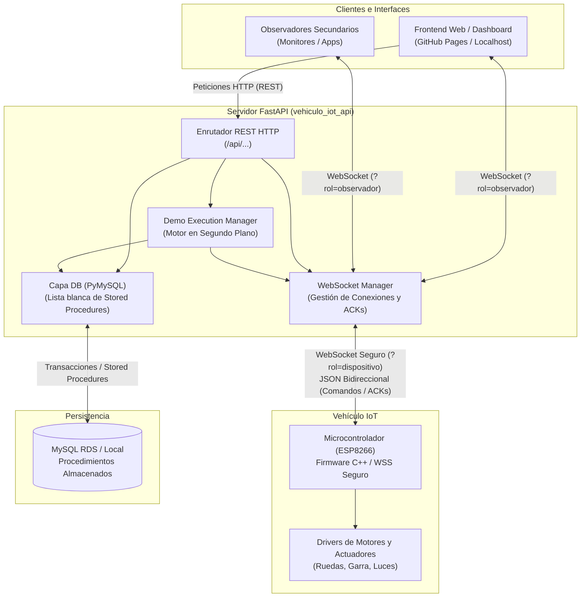
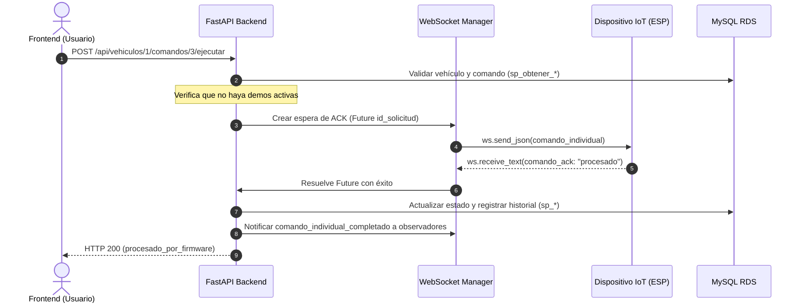

# 🚗 API Vehículo IoT

Sistema backend robusto desarrollado con **FastAPI**, **WebSockets** y **MySQL**, diseñado para el control bidireccional en tiempo real, gestión de secuencias de movimiento automatizadas (demos) y telemetría de vehículos robóticos IoT (microcontroladores ESP8266 / Arduino / ESP32).

---

## 📋 Tabla de Contenidos

- [Visión General](#-visión-general)
- [Arquitectura del Sistema](#-arquitectura-del-sistema)
- [Pila Tecnológica](#-pila-tecnológica)
- [Estructura del Proyecto](#-estructura-del-proyecto)
- [Protocolo de Comunicación WebSocket](#-protocolo-de-comunicación-websocket)
  - [Roles de Conexión](#roles-de-conexión)
  - [Mapeo de Códigos de Hardware](#mapeo-de-códigos-de-hardware)
  - [Mensajes y Eventos WebSocket](#mensajes-y-eventos-websocket)
- [Flujos de Operación](#-flujos-de-operación)
  - [1. Envío de Comandos Individuales](#1-envío-de-comandos-individuales)
  - [2. Ejecución de Demos y Rutinas](#2-ejecución-de-demos-y-rutinas)
  - [3. Modo Fallback (Sin Hardware Físico)](#3-modo-fallback-sin-hardware-físico)
- [Roles y Permisos](#-roles-y-permisos)
- [Catálogo de Endpoints REST](#-catálogo-de-endpoints-rest)
- [Base de Datos y Procedimientos Almacenados](#-base-de-datos-y-procedimientos-almacenados)
- [Instalación y Configuración](#-instalación-y-configuración)
- [Ejecución de Pruebas](#-ejecución-de-pruebas)

---

## 🎯 Visión General

El propósito central de esta API es actuar como **puente de coordinación y control** entre interfaces de usuario (paneles web/móviles), una base de datos relacional (registro histórico y catálogo de comandos) y el hardware físico del vehículo.

### Capacidades principales:
1. **Control en Tiempo Real**: Envío de comandos físicos (adelante, atrás, control de garra/actuadores) vía WebSockets con confirmación de recepción (**handshake ACK**).
2. **Motor de Demos Asíncrono**: Planificación y ejecución de rutinas preprogramadas en segundo plano con control estricto de duraciones (`duracion_ms`) y pausas (`pausa_ms`).
3. **Mecanismos de Seguridad y Concurrencia**: Exclusión mutua que evita que un comando manual interrumpa o colisione con una demo en curso, y apagado de emergencia inmediato (`APAGAR_TODO`).
4. **Soporte de Observadores y Modo Fallback**: Permite monitorear la actividad en vivo desde múltiples pantallas o probar la interfaz de control incluso cuando el vehículo físico no está conectado.
5. **Persistencia Transaccional**: Todo comando exitoso y cambio de estado se registra en MySQL mediante procedimientos almacenados seguros.
6. **Roles y Propiedad de Unidades**: Invitado, Usuario (comprador) y Administrador con autorización por unidad, comandos y demos propios, reportes de falla y acceso temporal de soporte (ver [Roles y Permisos](#-roles-y-permisos)).
7. **Dispositivo Compartido**: Una unidad registrada puede usar el ESP8266 de otra, para probar con un solo carrito físico registrado como exhibición, vendido y en stock.

---

## 🏗 Arquitectura del Sistema

El siguiente diagrama ilustra cómo interactúan los diferentes actores dentro del ecosistema del proyecto:



---

## 🛠 Pila Tecnológica

- **Lenguaje:** Python 3.10+
- **Framework Web:** FastAPI (construido sobre Starlette y AnyIO / Uvicorn)
- **Validación de Datos:** Pydantic v2 y Pydantic-Settings
- **Base de Datos:** MySQL (con soporte para AWS RDS o local)
- **Driver de Conexión:** PyMySQL (con soporte transaccional `autocommit=False` y cursores de tipo diccionario)
- **Comunicación en Vivo:** WebSockets nativos (ASGI)
- **Pruebas:** Unittest con AsyncIO y Mocks

---

## 📁 Estructura del Proyecto

```text
vehiculo_iot_api/
├── app/
│   ├── api/
│   │   ├── deps.py                 # Dependencias de sesión, rol y autorización por unidad; auditoría
│   │   └── routes/
│   │       ├── auth.py             # Login, renovación, logout y cambio de contraseña (JWT corto revocable)
│   │       ├── admin.py            # /api/admin: usuarios, inventario, modelos, asignaciones, comandos,
│   │       │                       #   demos de cualquier unidad, reportes, dashboard y bitácora
│   │       ├── mis_vehiculos.py    # /api/mis-vehiculos: unidades del comprador, comandos propios,
│   │       │                       #   demos privadas, reportes de falla y soporte temporal
│   │       ├── invitado.py         # Catálogo público y reserva temporal del invitado anónimo
│   │       ├── wss.py              # Ticket de un solo uso para abrir el WebSocket
│   │       ├── consultas.py        # Lectura: vehículo, comandos, estado, historial y demos
│   │       ├── operaciones.py      # CRUD de 4.1/4.2 (solo admin) y despacho de comandos / DETENER
│   │       ├── ejecucion_demos.py  # Iniciar y cancelar demos
│   │       ├── vehiculos.py        # Lista general de vehículos (solo admin)
│   │       └── websocket.py        # /ws/vehiculos/{id}: observadores y dispositivo (ESP8266)
│   ├── core/
│   │   ├── config.py               # Variables de entorno (Pydantic Settings)
│   │   ├── seguridad.py            # Argon2id, tokens JWT y huella de IP
│   │   └── websocket_manager.py    # Conexiones, ACK y dispositivo compartido (unidades espejo)
│   ├── db/                         # Conexión, lista blanca de procedimientos, transacciones y bajas lógicas
│   ├── repositories/               # SQL parametrizado: usuarios, sesiones, propiedad, inventario,
│   │                               #   demos, comandos propios, reportes, invitados y auditoría
│   ├── services/
│   │   ├── autorizacion.py         # Regla única de permisos por unidad (REST y WSS)
│   │   ├── auth.py                 # Inicio de sesión, límites de intentos y actor desde el token
│   │   ├── acceso_wss.py           # Tickets, token del ESP8266 y revalidación de conexiones
│   │   ├── demo_executor.py        # Motor asíncrono de demos
│   │   ├── validacion_demos.py     # Límites físicos de los pasos de una demo
│   │   └── vigilante.py            # Reservas vencidas, revalidación del WSS y dispositivo compartido
│   └── main.py                     # FastAPI, CORS, ciclo de vida y rutas
├── migrations/                     # V001–V009 (UP/DOWN) con su guía y diagrama ER
├── scripts/                        # migrar, respaldo/restaurar, crear_admin, preparar_pruebas y E2E
├── docs/                           # autenticación, despliegue 4.3, prueba por roles y esquema base
├── tests/                          # 107 pruebas unitarias sin base de datos (mocks)
├── requirements.txt
└── README.md
```

---

## 🔌 Protocolo de Comunicación WebSocket

La ruta del WebSocket es:
```text
/ws/vehiculos/{id_vehiculo}
```

### Roles de Conexión

Al conectarse al WebSocket, los clientes declaran su función usando query parameters:

| Rol | Query Parameter | Descripción |
| :--- | :--- | :--- |
| **Dispositivo** | `?rol=dispositivo` | Reservado para el **microcontrolador físico**. Recibe los comandos físicos y envía confirmaciones (`comando_ack`, `demo_ack`). Si se conecta un nuevo dispositivo con el mismo ID, la conexión previa se cierra limpiamente (código `1012`). |
| **Observador** | `?rol=observador` *(por defecto)* | Usado por **interfaces web o paneles de supervisión**. Recibe notificaciones de estado y eventos en tiempo real. En la ruta alterna (sin dispositivo), recibe los mensajes `comando_individual` para pruebas y simulación sin requerir flags adicionales. |
| **Observador (Compatibilidad)** | `?rol=observador&recibir_comandos=1` | Parámetro aceptado por compatibilidad histórica; ya no es necesario para recibir comandos en la ruta alterna. |

**Credenciales del canal (4.3):** el navegador pide primero `POST /api/ws/ticket` con su token y abre `?ticket=…` (un solo uso, 30 s); el token de sesión nunca va en la URL. El ESP8266 envía la cabecera `X-Dispositivo-Token` (o `?token=`), generada en ADMINISTRACIÓN → Inventario → Token ESP. Cada 15 s las conexiones se revalidan: si se pierde el permiso, se cierran con `4403`.

**Dispositivo compartido (V009):** si una unidad tiene `id_unidad_fisica`, la API manda sus órdenes al ESP8266 de esa otra unidad reescribiendo `id_vehiculo` (el firmware solo acepta el suyo), y avisa `dispositivo_estado` a los observadores de todas las unidades que lo comparten. Se configura en Inventario → Editar → «Dispositivo (ESP8266)».

---

### Mapeo de Códigos de Hardware

El microcontrolador físico traduce enteros recibidos por la API a instrucciones de control para los actuadores:

| Código Numérico | Equivalente Firmware | Significado / Acción |
| :---: | :---: | :--- |
| `0` | `'0'` | **APAGAR_TODO / STOP:** Detiene todos los motores y salidas. Se envía en detenciones manuales, al cancelar demos o ante pérdida de conexión. |
| `1` a `9` | `'1'` a `'9'` | Comandos de traslación o movimiento directo (adelante, atrás, giros, movimientos de garra/herramienta). |
| `10` | `'a'` | Movimiento especial extendido 1. |
| `11` | `'b'` | Movimiento especial extendido 2. |
| `12` | `'c'` | Movimiento especial extendido 3. |
| `13` | `'d'` | **Demo local autónoma del firmware:** *No permitido como comando individual vía API REST.* |

> [!NOTE]
> Para comandos individuales por la API, los códigos válidos son de **1 a 12**. El código **0** se despacha exclusivamente a través del endpoint dedicado `POST /api/vehiculos/{id}/detener`.

---

### Mensajes y Eventos WebSocket

#### 1. Del Servidor al Cliente (Dispositivo u Observadores)

- **`estado_inicial`**: Se envía inmediatamente tras conectar. Contiene el estado registrado en base de datos y la lista de demos.
- **`dispositivo_estado`**: Informa a los observadores si el vehículo físico está en línea (`conectado: true` o `false`).
- **`comando_individual`**: Enviado al dispositivo físico con la instrucción a ejecutar.
  ```json
  {
    "tipo": "comando_individual",
    "id_vehiculo": 1,
    "id_solicitud": "d3b07384-d113-4f93-b9ee-8fa1604a8b84",
    "id_comando": 3,
    "comando": "Avanzar",
    "codigo": 1
  }
  ```
- **`comando_individual_completado`**: Difundido a los observadores una vez que el comando fue procesado por el firmware o entregado al fallback.
- **`demo_iniciada`**, **`comando_demo`**, **`demo_completada`**, **`demo_cancelada`**, **`demo_error`**: Notificaciones del ciclo de vida de una rutina automatizada.

#### 2. Del Dispositivo Físico al Servidor

- **`comando_ack`**: Confirmación obligatoria tras recibir un comando.
  ```json
  {
    "tipo": "comando_ack",
    "id_vehiculo": 1,
    "id_solicitud": "d3b07384-d113-4f93-b9ee-8fa1604a8b84",
    "estado": "procesado"
  }
  ```
  *(Si el dispositivo está ocupado o detecta un problema, responde `"estado": "rechazado"` con un campo `"detalle"`).*
- **`demo_ack`**: Confirmación de aceptación al iniciar una demo:
  ```json
  {
    "tipo": "demo_ack",
    "id_vehiculo": 1,
    "id_demo": 2,
    "estado": "aceptado"
  }
  ```

---

## 🔄 Flujos de Operación

### 1. Envío de Comandos Individuales



- Si el dispositivo tarda más de **3.0 segundos** en responder el ACK, la API cancela la espera y responde con **HTTP 504 Gateway Timeout**.

---

### 2. Ejecución de Demos y Rutinas

Las demos son secuencias de movimientos almacenadas en MySQL que se ejecutan secuencialmente:

1. El usuario solicita iniciar la demo (`POST /api/vehiculos/{id}/demos/{id_demo}/ejecutar`).
2. La API carga los movimientos ordenados por el campo `orden`.
3. Se adquiere el bloqueo de concurrencia (`asyncio.Lock()`) y se valida que no haya comandos individuales o demos en ejecución.
4. Se despacha `demo_iniciada` al vehículo y se espera un `demo_ack` (tiempo límite: 12 s).
5. Por cada movimiento:
   - Se envía `comando_demo` con el código y tiempos.
   - Se espera el `comando_ack` del dispositivo (tiempo límite: 10 s).
   - Se actualiza el estado e historial en base de datos.
   - Se espera de forma asíncrona la duración (`duracion_ms / 1000`) y la pausa configurada (`pausa_ms / 1000`).
6. Al finalizar todos los pasos, se envía `demo_completada`.
7. Si el usuario llama a `POST /.../demos/cancelar`, la tarea se interrumpe, se envía de inmediato el comando `codigo: 0` (`APAGAR_TODO`) al vehículo y se notifica `demo_cancelada`.

---

### 3. Modo Fallback y Ruta Alterna (Sin Dispositivo Físico)

Cuando se prueba la plataforma, se desarrolla el frontend o el vehículo físico (ESP) no está conectado, el sistema cuenta con un mecanismo de **ruta alterna** para no bloquear la ejecución de comandos, la detención ni las demos:

> [!NOTE]
> **Ya no hace falta `?recibir_comandos=1`**: ahora todos los observadores conectados al vehículo (con o sin parámetros en `/ws/vehiculos/{id}`) reciben los mensajes de comando en la ruta alterna. El parámetro se mantiene aceptado únicamente por compatibilidad hacia atrás sin alterar el comportamiento.

#### Los Tres Escenarios de Despacho:

1. **Con Dispositivo Conectado:**
   - La orden física se despacha prioritariamente al microcontrolador (`rol=dispositivo`).
   - Se espera el `comando_ack` hasta por 3.0 segundos.
   - Los observadores **no** reciben `comando_individual`; únicamente reciben el evento de finalización `comando_individual_completado` con `"mensaje": "El comando se ejecutó correctamente."`.
   - Responde HTTP 200 con `"estado": "procesado_por_firmware"`.
   - Si la conexión con el dispositivo falla o el socket se encuentra muerto durante el envío, el socket se descarta automáticamente del gestor y la petición continúa **en la misma llamada** hacia la ruta alterna.

2. **Sin Dispositivo pero con al menos un Observador Conectado:**
   - Se despacha a **todos los observadores conectados** el mensaje JSON `"comando_individual"`.
   - **No se espera ACK** de vuelta.
   - Inmediatamente después, se publica a los observadores el evento `"comando_individual_completado"` con el texto `"El comando se entregó a observadores; sin confirmación de firmware."` (tanto para comandos estándar como para `APAGAR_TODO` y movimientos de demo).
   - Responde HTTP 200 con estado `"entregado_a_observadores"`:
     ```json
     {
       "mensaje": "No hay dispositivo conectado; el comando se entregó a 1 cliente(s) WebSocket.",
       "id_solicitud": "7cf73812-7065-4f40-b461-ca5fa9d1ad9f",
       "estado": "entregado_a_observadores",
       "resultados": []
     }
     ```
   - **Aviso de telemetría:** El estado `"entregado_a_observadores"` indica entrega a clientes WebSocket observadores conectados; **no representa una confirmación de ejecución física** en motores o sensores.

3. **Sin Dispositivo ni Observadores Conectados:**
   - Responde HTTP 409 Conflict:
     ```json
     {
       "detail": "No hay un dispositivo WebSocket conectado."
     }
     ```

---

## 👥 Roles y Permisos

Todas las rutas exigen sesión (`AUTH_OBLIGATORIA=true` en producción). El rol y el dueño se leen de la base en cada petición; nunca se toman del cliente. Una unidad ajena responde **404**, igual que una inexistente.

| Rol | Unidades que controla | Comandos | Demos |
| :--- | :--- | :--- | :--- |
| **Invitado** (cuenta `invitado`, o reserva anónima de 5 min desde el catálogo) | Solo las de **exhibición** | Ejecuta los marcados «Invitados» por el admin; no crea ni borra | Ejecuta las de fábrica; no crea ni borra |
| **Usuario** (comprador) | Solo la que tiene **asignada** | Crea comandos propios a partir de un movimiento ya registrado (otro código → 422) y borra solo los suyos | Crea, edita (agregar/quitar/reordenar pasos) y borra solo las suyas; las de fábrica son de solo lectura |
| **Administrador** | Exhibición y stock; una **vendida** solo con autorización de soporte vigente del comprador (si no, 403) | Crea, edita, desactiva y gestiona los permisos de invitado de todos | Crea de fábrica y edita/borra **cualquiera**, incluso las privadas (gestionar no es ejecutar) |

**Acceso temporal:** el comprador reporta una falla (`POST /api/mis-vehiculos/{id}/reportes`) y puede autorizar soporte por 15 min a 24 h; el admin lo atiende en Reportes y, al marcarlo «resuelto», la autorización se revoca y su WebSocket se cierra. El comprador también puede otorgarla o revocarla en cualquier momento.

Matriz completa y tokens en [`docs/autenticacion.md`](docs/autenticacion.md); guion de la prueba con las tres cuentas en [`docs/prueba_roles.md`](docs/prueba_roles.md).

---

## 📡 Catálogo de Endpoints REST

La API documenta todos sus esquemas interactivamente a través de **Swagger UI** en `/docs` (73 operaciones). Las tablas 2, 3 y 5 son las rutas originales de 4.1/4.2: las de escritura son **solo para el administrador**.

### 1. Estado y Diagnóstico General

| Método | Ruta | Descripción | Respuestas |
| :--- | :--- | :--- | :--- |
| `GET` | `/` | Comprueba que el servicio esté arriba y muestra el entorno. | `200 OK` |
| `GET` | `/health/db` | Comprueba la conectividad con MySQL y devuelve su versión. | `200 OK`, `503 Service Unavailable` |

### 2. Vehículos

| Método | Ruta | Descripción | Respuestas |
| :--- | :--- | :--- | :--- |
| `GET` | `/api/vehiculos` | Lista todos los vehículos registrados. | `200 OK` |
| `GET` | `/api/vehiculos/{id}` | Obtiene el detalle de un vehículo específico. | `200 OK`, `404 Not Found` |
| `POST` | `/api/vehiculos` | Da de alta un nuevo vehículo. | `201 Created` |
| `PUT` | `/api/vehiculos/{id}` | Actualiza datos y el estado `activo` del vehículo. | `200 OK` |
| `DELETE`| `/api/vehiculos/{id}` | **Baja lógica**: marca `activo = 0` y conserva comandos, demos e historial. Ya no borra filas. | `200 OK`, `404 Not Found` |

### 3. Comandos de Vehículos

| Método | Ruta | Descripción | Respuestas |
| :--- | :--- | :--- | :--- |
| `GET` | `/api/vehiculos/{id}/comandos` | Lista los comandos asociados al vehículo. | `200 OK` |
| `POST` | `/api/vehiculos/{id}/comandos` | Crea un nuevo comando asignado al vehículo. | `201 Created` |
| `PUT` | `/api/comandos/{id_comando}` | Actualiza nombre, código o estado de un comando. | `200 OK` |
| `DELETE`| `/api/comandos/{id_comando}` | **Desactiva** el comando (`activo = 0`). Un borrado físico dejaría filas del historial con comando NULL, que significa DETENER. | `200 OK`, `404 Not Found` |

### 4. Control y Despacho en Vivo

| Método | Ruta | Descripción | Respuestas |
| :--- | :--- | :--- | :--- |
| `POST` | `/api/vehiculos/{id}/comandos/{id_cmd}/ejecutar` | Envía el comando al vehículo y espera confirmación ACK del firmware. | `200 OK`, `404 Not Found`, `409 Conflict`, `504 Timeout` |
| `POST` | `/api/vehiculos/{id}/detener` | Envía el código de emergencia `0` para apagar todas las salidas. **Tiene prioridad**: si hay una demo en curso la cancela (la respuesta trae `demo_cancelada: true`), y si hay un comando individual pendiente no lo espera para enviar la orden física, solo para registrar su fila después. Mientras se ejecuta, los comandos individuales y las demos nuevas reciben 409. | `200 OK`, `409 Conflict` (sin clientes WebSocket o rechazo del firmware), `504 Timeout` |

### 5. Demos y Movimientos Automatizados

| Método | Ruta | Descripción | Respuestas |
| :--- | :--- | :--- | :--- |
| `GET` | `/api/vehiculos/{id}/demos` | Lista las demos registradas para el vehículo. | `200 OK` |
| `POST` | `/api/vehiculos/{id}/demos` | Crea una nueva rutina o demo. | `201 Created` |
| `PUT` | `/api/demos/{id_demo}` | Actualiza el nombre, descripción o estado de la demo. | `200 OK` |
| `DELETE`| `/api/demos/{id_demo}` | Elimina la demo. | `200 OK` |
| `GET` | `/api/demos/{id_demo}/movimientos` | Lista los movimientos y tiempos de la demo. | `200 OK` |
| `POST` | `/api/demos/{id_demo}/movimientos` | Agrega un movimiento a la demo (`id_comando`, `orden`, `duracion_ms`, `pausa_ms`). | `201 Created` |
| `PUT` | `/api/movimientos-demo/{id_mov}` | Modifica los parámetros de un movimiento. | `200 OK` |
| `DELETE`| `/api/movimientos-demo/{id_mov}` | Elimina un movimiento de la demo. | `200 OK` |
| `POST` | `/api/vehiculos/{id}/demos/{id_demo}/ejecutar` | Inicia la secuencia automatizada en segundo plano. Responde 409 si el vehículo está dado de baja o si algún paso usa un comando desactivado, de otra unidad o con código fuera de 1–12. | `202 Accepted`, `404 Not Found`, `409 Conflict` |
| `POST` | `/api/vehiculos/{id}/demos/cancelar` | Detiene y cancela la demo en curso inmediatamente. | `200 OK`, `409 Conflict` |

### 6. Telemetría e Historial

| Método | Ruta | Descripción | Respuestas |
| :--- | :--- | :--- | :--- |
| `GET` | `/api/vehiculos/{id}/estado` | Consulta el estado en BD y si el WebSocket físico está en línea. | `200 OK` |
| `PUT` | `/api/vehiculos/{id}/estado` | Actualiza el estado del vehículo y notifica vía WebSocket. | `200 OK` |
| `GET` | `/api/vehiculos/{id}/historial` | Consulta el registro histórico de eventos del vehículo. | `200 OK` |
| `POST` | `/api/vehiculos/{id}/historial` | Registra manualmente un evento en el historial. | `201 Created` |

### 7. Sesión, comprador y administración (4.3 y V009)

| Método | Ruta | Quién | Descripción |
| :--- | :--- | :--- | :--- |
| `POST` | `/api/auth/login` · `renovar` · `logout` · `GET /api/auth/yo` | todos | Sesión con token de 30 min, renovable hasta 8 h |
| `GET` | `/api/mis-vehiculos` | usuario | Sus unidades, soporte vigente y reportes abiertos |
| `GET` `POST` `DELETE` | `/api/mis-vehiculos/{id}/comandos[/{id_comando}]` | usuario | Comandos propios y movimientos base disponibles |
| `GET` `POST` `PUT` `DELETE` | `/api/mis-vehiculos/{id}/demos[/{id_demo}]` | usuario | Demos privadas (lista completa de pasos en cada guardado) |
| `GET` `POST` | `/api/mis-vehiculos/{id}/reportes` | usuario | Reportar falla y, opcionalmente, autorizar soporte |
| `POST` `DELETE` | `/api/mis-vehiculos/{id}/soporte` | usuario | Otorgar o revocar el acceso temporal |
| `GET` `POST` | `/api/catalogo` · `/api/invitado/sesiones` | público | Catálogo y reserva temporal del invitado anónimo |
| `POST` | `/api/ws/ticket` | con acceso a la unidad | Ticket de un solo uso para el WebSocket |
| `GET` `POST` `PUT` | `/api/admin/usuarios[/{id}]` | admin | Cuentas con rol `admin`, `usuario` o `invitado` |
| `GET` `POST` `PUT` | `/api/admin/inventario` · `modelos` · `unidades` | admin | Unidades (incluye `id_unidad_fisica`), modelos y token del ESP8266 |
| `GET` `PUT` | `/api/admin/unidades/{id}/comandos` · `/api/admin/comandos/{id}` | admin | Todos los comandos con su dueño; activo, invitados y tope |
| `GET` `POST` `PUT` `DELETE` | `/api/admin/unidades/{id}/demos` · `/api/admin/demos/{id}` | admin | Gestión de cualquier demo |
| `GET` `PUT` | `/api/admin/reportes[/{id}]` | admin | Revisar y resolver (revoca el soporte) |
| `GET` `POST` | `/api/admin/asignaciones` · `dashboard` · `auditoria` | admin | Ventas, métricas y bitácora |

---

## 🗄 Base de Datos y Procedimientos Almacenados

La API delega las operaciones SQL a **Stored Procedures** de MySQL por razones de seguridad, optimización y consistencia de datos.

### Lista Blanca de Seguridad (`ALLOWED_PROCEDURES`)
Para evitar inyecciones SQL dinámicas, el ejecutor (`app/db/procedure_executor.py`) valida estrictamente que sólo se invoquen procedimientos autorizados:

```text
sp_crear_vehiculo             sp_actualizar_estado
sp_obtener_vehiculos          sp_obtener_estado
sp_obtener_vehiculo           sp_registrar_historial
sp_actualizar_vehiculo        sp_obtener_historial
sp_crear_comando              sp_crear_demo
sp_obtener_comandos_vehiculo  sp_obtener_demos
sp_actualizar_comando         sp_actualizar_demo
sp_obtener_movimientos_demo   sp_eliminar_demo
sp_agregar_movimiento_demo    sp_actualizar_movimiento_demo
sp_eliminar_movimiento_demo
```

`sp_eliminar_vehiculo` y `sp_eliminar_comando` siguen existiendo en RDS, pero **se retiraron de la lista blanca**: hacen `DELETE` físico, y las llaves foráneas borrarían en cascada el historial del vehículo o pondrían en NULL (= DETENER) el comando de filas del historial. Las bajas se hacen con `UPDATE ... SET activo = 0` parametrizado en `app/db/bajas_logicas.py`. El esquema real de referencia está en `docs/esquema_base_2026-11-18.sql`.

### Despliegue de la 4.3

Orden de despliegue, activación de `AUTH_OBLIGATORIA` / `DISPOSITIVO_TOKEN_OBLIGATORIO`, alta de la unidad vendida de un compañero y guion de la prueba por equipos: [`docs/despliegue_4.3.md`](docs/despliegue_4.3.md).

### Autenticación y roles (4.3)

Inicio de sesión con token corto revocable, roles `admin`/`usuario` y autorización por unidad (propiedad + consentimiento de soporte) en todas las rutas. Contrato, matriz de permisos, pruebas y pasos de despliegue en [`docs/autenticacion.md`](docs/autenticacion.md).

### Migraciones (4.3)

El esquema se amplía con migraciones versionadas UP/DOWN en [`migrations/`](migrations/README.md): usuarios y sesiones, modelos y unidades, asignaciones, demos privadas, sesiones de invitado, auditoría, autoría del historial, FK en RESTRICT y, en **V009**, rol `invitado`, comandos propios, reportes de falla y dispositivo compartido. Se aplican con `scripts/migrar.py`, después de un respaldo verificable con `scripts/respaldo_bd.py`. La guía tiene el diagrama ER, el checklist y el plan de reversión.

Cada conexión de la API abre la sesión con `sql_mode` estricto y `time_zone` UTC (`app/db/connection.py`). Así, un valor fuera de rango falla en vez de truncarse en silencio.

### Gestión Transaccional
Las operaciones de escritura en `app/db/operation_executor.py` ejecutan los procedimientos dentro de una transacción explícita:
- Si todos los procedimientos de la operación concluyen con éxito: se aplica `connection.commit()`.
- Ante cualquier error o excepción de MySQL: se aplica `connection.rollback()` y se devuelve una respuesta `HTTP 500`.

---

## 🚀 Instalación y Configuración

### 1. Prerrequisitos
- **Python 3.10** o superior instalado en el sistema.
- Servidor **MySQL** accesible (local o en la nube como AWS RDS).

### 2. Clonar el proyecto y preparar el entorno

```bash
# 1. Crear el entorno virtual
python -m venv .venv
```

Activar el entorno:
- **En Windows (PowerShell):**
  ```powershell
  .\.venv\Scripts\Activate.ps1
  ```
- **En Linux / macOS:**
  ```bash
  source .venv/bin/activate
  ```

Instalar las librerías necesarias:
```bash
pip install -r requirements.txt
```

### 3. Configuración de Variables de Entorno

Crea un archivo llamado `.env` en la raíz del proyecto basándote en la siguiente tabla:

| Variable | Descripción | Valor Ejemplo | Obligatoria |
| :--- | :--- | :--- | :---: |
| `DB_HOST` | Host o dirección IP del servidor MySQL | `localhost` o `xxxx.rds.amazonaws.com` | Sí |
| `DB_PORT` | Puerto de conexión MySQL | `3306` | No (por defecto 3306) |
| `DB_NAME` | Nombre de la base de datos | `vehiculo_iot` | No (por defecto vehiculo_iot) |
| `DB_USER` | Usuario con permisos en la base de datos | `admin` | Sí |
| `DB_PASSWORD` | Contraseña del usuario MySQL | `tu_contraseña_segura` | Sí |
| `DB_CONNECT_TIMEOUT` | Tiempo límite de espera para conectar (segundos) | `10` | No (por defecto 10) |
| `APP_NAME` | Título del servicio reportado en OpenAPI | `API Vehiculo IoT` | No |
| `APP_ENV` | Identificador de entorno (`development` / `production`) | `development` | No |
| `AUTH_SECRET` | Secreto para firmar los tokens (generar con `secrets.token_urlsafe(48)`); sin él, las sesiones caducan al reiniciar | — | Sí en producción |
| `AUTH_OBLIGATORIA` | `true` exige sesión en CONTROL y MONITOREO (producción); `false` es el modo de transición | `true` | No (por defecto false) |
| `DISPOSITIVO_TOKEN_OBLIGATORIO` | `true` rechaza un ESP8266 sin token registrado | `true` | No (por defecto false) |
| `INVITADO_MINUTOS` | Duración de la reserva del invitado anónimo | `5` | No |

Ejemplo de archivo `.env`:
```dotenv
DB_HOST=localhost
DB_PORT=3306
DB_NAME=vehiculo_iot
DB_USER=root
DB_PASSWORD=secret
DB_CONNECT_TIMEOUT=10
APP_NAME=API Vehiculo IoT
APP_ENV=development
```

### 4. Iniciar el Servidor de Desarrollo

```bash
uvicorn app.main:app --reload --host 0.0.0.0 --port 8000
```

- **API Local:** `http://localhost:8000`
- **Documentación Interactiva (Swagger):** `http://localhost:8000/docs`
- **Documentación Alternativa (ReDoc):** `http://localhost:8000/redoc`

---

## 🧪 Ejecución de Pruebas

La suite tiene **107 pruebas** unitarias y asíncronas en 6 archivos (`test_command_flow`, `test_detener_y_bajas`, `test_autorizacion`, `test_demos_privadas`, `test_invitados_wss` y `test_roles_v009`). Cubren el flujo de comandos y ACK, DETENER, bajas lógicas, la matriz de permisos, demos privadas, invitados, WebSocket autenticado, comandos propios, reportes y dispositivo compartido, sin base de datos (mocks):

```bash
python -m unittest discover tests
```

Pruebas de punta a punta contra una API real:

```bash
python scripts/probar_roles_e2e.py --api https://vehiculo-iot-itp.duckdns.org --cuentas cuentas_prueba.local.txt
```

`scripts/preparar_pruebas.py` deja listas (de forma idempotente) las cuentas de Invitado, Usuario y Administrador y las unidades que comparten el ESP8266; escribe las contraseñas solo en `cuentas_prueba.local.txt` (ignorado por git). `probar_roles_e2e.py` (48 casos) mueve brevemente la garra si el carrito está conectado. También están `probar_auth_e2e.py` y `probar_invitado_wss_e2e.py`.

---

## 🔒 Consideraciones de Seguridad y CORS

1. **CORS:** El archivo `app/main.py` define una política estricta de orígenes permitidos que incluye entornos locales (`localhost:3000`) y la URL de producción alojada en GitHub Pages (`https://80chucho08.github.io`). CORS no sustituye la autorización: cada ruta valida rol y propiedad.
2. **Autenticación:** tokens JWT de 30 min revocables (sesión en base de datos), contraseñas con Argon2id, bloqueo tras 5 intentos y límite por IP. La API corre detrás de Caddy (TLS) en la EC2. Toda acción administrativa y todo acceso denegado queda en la bitácora `auditoria`.
3. **Certificados TLS para WebSockets (WSS):** El cliente ESP8266 requiere validar la cadena SSL mediante la autoridad certificadora raíz (CA) configurada en su firmware para conexiones seguras sobre WSS.
