# Migraciones de la base `vehiculo_iot` (práctica 4.3 ADMINISTRACIÓN)

Las migraciones amplían el esquema de 4.1/4.2 **sin borrar tablas, sin vaciar filas y sin cambiar IDs**. La línea base es [`docs/esquema_base_2026-11-18.sql`](../docs/esquema_base_2026-11-18.sql) (6 tablas y 21 procedimientos).

## Modelo entidad-relación resultante

`vehiculos` sigue siendo la **unidad física**; `modelos_vehiculo` es el **catálogo comercial**. Ya existían `vehiculos`, `comandos`, `estado_vehiculo`, `historial_comandos`, `demos` y `demo_movimientos`; las demás son nuevas.

```mermaid
erDiagram
    MODELOS_VEHICULO ||--o{ VEHICULOS : "clasifica"
    VEHICULOS ||--o| CREDENCIALES_DISPOSITIVO : "token ESP8266"
    VEHICULOS ||--o{ COMANDOS : "tiene"
    VEHICULOS ||--|| ESTADO_VEHICULO : "estado"
    VEHICULOS ||--o{ HISTORIAL_COMANDOS : "registra"
    COMANDOS |o--o{ HISTORIAL_COMANDOS : "NULL = DETENER"
    VEHICULOS ||--o{ DEMOS : "compatible con"
    DEMOS ||--o{ DEMO_MOVIMIENTOS : "pasos ordenados"
    COMANDOS ||--o{ DEMO_MOVIMIENTOS : "usa"
    USUARIOS |o--o{ DEMOS : "dueño (privada)"
    USUARIOS ||--o{ ASIGNACIONES : "comprador"
    VEHICULOS ||--o{ ASIGNACIONES : "unidad vendida"
    USUARIOS ||--o{ AUTORIZACIONES_SOPORTE : "otorga"
    VEHICULOS ||--o{ AUTORIZACIONES_SOPORTE : "sobre"
    VEHICULOS ||--o{ SESIONES_INVITADO : "reserva de exhibición"
    USUARIOS ||--o{ SESIONES_USUARIO : "inicia"
    USUARIOS |o--o{ AUDITORIA : "actor"
    USUARIOS |o--o{ HISTORIAL_COMANDOS : "quién"
    SESIONES_INVITADO |o--o{ HISTORIAL_COMANDOS : "quién (invitado)"

    VEHICULOS {
        int id_vehiculo PK
        varchar modelo "texto original, se conserva"
        int id_modelo FK "V002"
        varchar numero_serie UK "V002"
        enum tipo_unidad "venta|exhibicion|simulada (V002)"
        tinyint activo "baja lógica"
    }
    COMANDOS {
        int id_comando PK
        int codigo "UNIQUE por unidad"
        int duracion_max_ms "V002"
        tinyint permitido_invitado "V002"
    }
    DEMOS {
        int id_demo PK
        enum tipo "fabrica|privada (V004)"
        int id_propietario FK "V004"
    }
    DEMO_MOVIMIENTOS {
        int orden "UNIQUE por demo"
        int duracion_ms "CHECK <= 10000 (V004)"
        int pausa_ms "CHECK <= 10000 (V004)"
    }
    HISTORIAL_COMANDOS {
        bigint id_historial PK
        varchar origen
        int id_usuario FK "V007"
        bigint id_sesion_invitado FK "V007"
    }
    USUARIOS {
        int id_usuario PK
        varchar email UK
        varchar password_hash
        enum rol "admin|usuario"
    }
    ASIGNACIONES {
        int id_asignacion PK
        timestamp fin "NULL = vigente"
        int vehiculo_activo UK "generada: una activa por unidad"
    }
    SESIONES_INVITADO {
        bigint id_sesion_invitado PK
        timestamp expira_en
        int vehiculo_reservado UK "generada: reserva exclusiva"
    }
    SESIONES_USUARIO {
        char sid UK
        timestamp expira_absoluto "tope 8 h"
        timestamp revocada_en
    }
    AUDITORIA {
        bigint id_auditoria PK
        varchar accion
        json detalle
    }
```

## Versiones (aplicar en este orden)

| Versión | Qué hace | Tablas originales que toca | Reversible (DOWN) |
|---|---|---|---|
| V001 | `usuarios`, `sesiones_usuario` | ninguna | sí (borra usuarios) |
| V002 | `modelos_vehiculo`, `credenciales_dispositivo`; `vehiculos` + `id_modelo`, `numero_serie`, `tipo_unidad`; `comandos` + `duracion_max_ms`, `permitido_invitado`. Migra datos: modelo «Carrito grúa», serie `UNI-0001`, unidad 1 = exhibición, invitados con códigos 1–4 y 8–12 | `vehiculos`, `comandos` (columnas nuevas, mismas filas) | sí |
| V003 | `asignaciones` (una activa por unidad), `autorizaciones_soporte` | ninguna | sí |
| V004 | `demos` + `tipo`, `id_propietario`; CHECK de 10 s por paso y pausa | `demos`, `demo_movimientos` | sí |
| V005 | `sesiones_invitado` (reserva exclusiva) | ninguna | sí |
| V006 | `auditoria` | ninguna | sí |
| V007 | `historial_comandos` + `id_usuario`, `id_sesion_invitado` e índice `(id_vehiculo, id_historial)` | `historial_comandos` (columnas nuevas, filas intactas) | sí |
| V008 | FK de `comandos`, `demos`, `estado_vehiculo` e `historial_comandos` hacia `vehiculos`/`comandos`: de CASCADE/SET NULL a **RESTRICT** al borrar | solo las FK | sí (vuelve a CASCADE) |

Compatibilidad comprobada: los 21 procedimientos siguen funcionando; los `INSERT` de los SP usan lista de columnas y las columnas nuevas aceptan NULL o tienen DEFAULT. Por el `SELECT *` de los SP de lectura, `GET /api/vehiculos` y `/comandos` muestran las columnas nuevas (ninguna es secreta; el hash del token del ESP8266 está en otra tabla). `GET /historial` conserva exactamente sus 6 columnas.

## Herramientas (`scripts/`)

| Script | Para qué | ¿Escribe? |
|---|---|---|
| `respaldo_bd.py` | Respaldo lógico con manifiesto (conteos, `CHECKSUM TABLE`, SHA-256) en `respaldos/` | No (snapshot consistente de solo lectura) |
| `restaurar_bd.py` | Restaura un respaldo en una base **nueva** y lo verifica contra el manifiesto | Solo en la base destino; rechaza producción |
| `migrar.py` | `estado`, `subir`, `bajar` con control de versiones, `@requiere`/`@comprobar` y conteos antes/después | Sí |
| `verificar_esquema.py` | 38 casos: compatibilidad de los 21 SP y que cada restricción nueva rechace lo indebido | Dentro de una transacción con ROLLBACK; rechaza producción |

`migrar.py` en producción exige `--confirmar-produccion vehiculo_iot` y un respaldo de menos de 6 h. MySQL hace **commit implícito en cada DDL**: no hay rollback transaccional. Si una versión falla a la mitad, el runner dice qué sentencia falló y no la registra; la reversión real es el respaldo.

## Ensayo realizado en `vehiculo_iot_prueba` (2026-11-19)

1. Respaldo de producción → restaurado en `vehiculo_iot_prueba`: conteos, checksums y las 21 rutinas idénticas (byte a byte).
2. `subir` V001–V008: sin pérdida de filas (historial 896 → 896).
3. `verificar_esquema.py`: **38/38**.
4. `bajar --hasta 0`: las 6 tablas originales quedan con DDL, conteos y checksums **idénticos a producción**.
5. `subir` otra vez, `bajar --hasta 4` y `subir`: 38/38 de nuevo.
6. La API (código actual, con sesión estricta) contra la base migrada: mismas respuestas, 422 para pasos de más de 10 s y baja lógica correcta.

## Aplicación en producción: 2026-11-19 02:11 UTC

Snapshot manual de RDS tomado por el usuario → respaldo `vehiculo_iot_20261119T021056Z` (verificado restaurándolo en prueba) → V001–V008 aplicadas en `vehiculo_iot` en unos 4 s. Conteos sin pérdidas (historial 904 → 904). Las columnas originales de las 6 tablas coinciden fila por fila con el respaldo. Los 21 procedimientos siguen presentes y la API desplegada responde igual.

## Checklist para aplicar en producción

1. [ ] **Snapshot manual de RDS** desde la consola de AWS (RDS → instancia → Acciones → Tomar instantánea). Esperar a que quede *Disponible*.
2. [ ] `python scripts/respaldo_bd.py` → anota el archivo y los conteos.
3. [ ] Opcional pero recomendado: `python scripts/restaurar_bd.py respaldos/<archivo>.sql --bd vehiculo_iot_prueba --recrear`. Debe decir «VERIFICACIÓN OK».
4. [ ] `python scripts/migrar.py --bd vehiculo_iot estado` → V001–V008 pendientes.
5. [ ] `python scripts/migrar.py --bd vehiculo_iot --confirmar-produccion vehiculo_iot subir` (los flags globales van antes del subcomando).
6. [ ] Revisar que los conteos finales sean ≥ a los del paso 2.
7. [ ] Desplegar la API (`git pull` y reiniciar la tarea `Vehiculo IoT API`) y probar CONTROL y MONITOREO.

**Si algo sale mal:** no se ejecutan los DOWN en producción. Opción A: restaurar el snapshot de RDS (crea una instancia nueva). Opción B: `restaurar_bd.py respaldos/<archivo>.sql --bd vehiculo_iot_restaurada` y cambiar `DB_NAME` en el `.env` de la EC2.

## Privilegios mínimos

Hoy la API se conecta con `admin`, el usuario master de RDS. [`docs/privilegios_rds.sql`](../docs/privilegios_rds.sql) propone dos usuarios separados: `vehiculo_app` (sin DDL, sin DELETE, solo INSERT en auditoría e historial) y `vehiculo_migrador` (DDL solo sobre estas bases). Las contraseñas las generas tú; nunca van a git.
